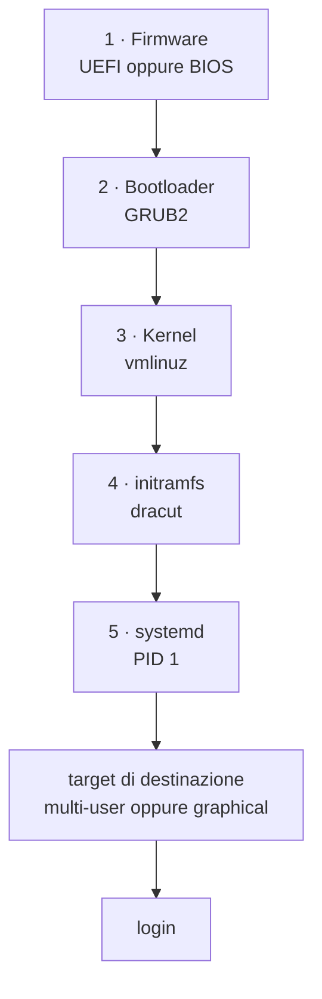
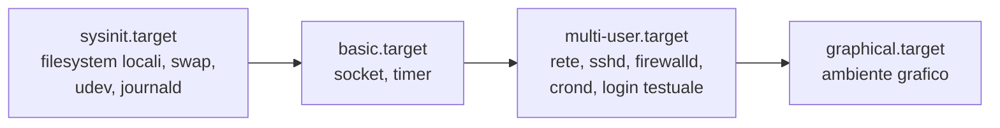

# Avvio di Rocky Linux, e i comandi `systemctl`, `journalctl`, `dmesg`

## 1. La sequenza di avvio

Dall'accensione al prompt di login passano cinque fasi. Ognuna carica la
successiva e le consegna il controllo.



| Fase | Che cosa fa | Dove sta | Come si guarda |
|---|---|---|---|
| **1 · Firmware** | controlla l'hardware (POST), sceglie il disco d'avvio, carica il bootloader | UEFI: partizione EFI, innestata su `/boot/efi`. BIOS: primo settore del disco (MBR) | `ls /sys/firmware/efi` (se esiste, l'avvio è UEFI) · `efibootmgr` |
| **2 · GRUB2** | mostra il menu, sceglie kernel e parametri, carica in memoria kernel e initramfs | `/boot/grub2/grub.cfg` · voci del menu in `/boot/loader/entries/*.conf` · impostazioni in `/etc/default/grub` | `sudo grubby --info=ALL` · `sudo grubby --default-kernel` |
| **3 · Kernel** | si decomprime, riconosce l'hardware, innesta l'initramfs come radice provvisoria | `/boot/vmlinuz-<versione>` | `uname -r` · `cat /proc/cmdline` · `sudo dmesg` |
| **4 · initramfs** | piccolo sistema in memoria con i driver necessari a raggiungere la radice vera (disco, LVM, cifratura); la innesta e le cede il posto (*switch root*) | `/boot/initramfs-<versione>.img`, costruito da `dracut` | `sudo lsinitrd \| less` |
| **5 · systemd** | primo processo (PID 1): innesta i filesystem di `/etc/fstab`, avvia i servizi in parallelo secondo le dipendenze, fino al *target* di destinazione | unità in `/usr/lib/systemd/system/` (del sistema) e `/etc/systemd/system/` (dell'amministratore, hanno la precedenza) | `systemctl get-default` · `systemd-analyze` |

### La fase 5 più da vicino: i *target*

Un **target** è un gruppo di unità che descrive uno stato del sistema. systemd
non esegue una lista in sequenza: calcola le dipendenze del target di
destinazione e avvia in parallelo tutto ciò che serve a raggiungerlo.



| Target | Stato del sistema | Vecchio *runlevel* |
|---|---|---|
| `poweroff.target` | spento | 0 |
| `rescue.target` | utente singolo: filesystem innestati, pochi servizi, shell di root | 1 |
| `multi-user.target` | completo, senza grafica: il normale per un server | 3 |
| `graphical.target` | completo, con ambiente grafico | 5 |
| `reboot.target` | riavvio | 6 |
| `emergency.target` | shell di root con la sola radice, in sola lettura: vi si finisce quando l'avvio fallisce | — |

```sh
systemctl get-default                          # target di destinazione all'avvio
sudo systemctl set-default multi-user.target   # cambiarlo in modo permanente
sudo systemctl isolate rescue.target           # passare subito a un altro target
```

### Intervenire sull'avvio dal menu di GRUB

Nel menu di GRUB il tasto **`e`** apre la voce in modifica; i parametri si
aggiungono in fondo alla riga che comincia con `linux`; **`Ctrl+X`** avvia. La
modifica vale per quel solo avvio.

| Parametro aggiunto | Effetto |
|---|---|
| `systemd.unit=rescue.target` | avvio in modalità di soccorso (chiede la password di root) |
| `systemd.unit=emergency.target` | avvio in emergenza |
| `rd.break` | si ferma **dentro l'initramfs**, prima del passaggio alla radice vera: è la via per la password di root perduta (scheda `S01`) |
| togliere `rhgb quiet` | mostra i messaggi dell'avvio anziché la schermata grafica |

Per una modifica permanente dei parametri del kernel:

```sh
sudo grubby --update-kernel=ALL --args="parametro=valore"
sudo grubby --update-kernel=ALL --remove-args="rhgb quiet"
```

### Quanto è durato l'avvio, e che cosa lo ha rallentato

```sh
systemd-analyze                    # tempo totale: firmware, loader, kernel, initrd, userspace
systemd-analyze blame              # le unità, dalla più lenta
systemd-analyze critical-chain     # la catena di dipendenze che ha determinato il tempo
```

### Quando l'avvio si ferma

| Sintomo | Causa più frequente | Dove guardare |
|---|---|---|
| prompt `grub>` o `grub rescue>` | GRUB non trova la configurazione o `/boot` | avvio dal disco d'installazione, modalità *rescue* |
| `Kernel panic - not syncing: VFS: Unable to mount root fs` | initramfs mancante o senza il driver del disco | scegliere dal menu il kernel precedente; `dracut -f` |
| prompt `dracut:/#` | la radice non si trova: UUID o volume LVM sbagliato | `blkid`, `lvm lvs`, parametri `root=` e `rd.lvm.lv=` |
| `You are in emergency mode` | una riga di `/etc/fstab` punta a un dispositivo che non c'è | `journalctl -xb`, correggere `/etc/fstab` |
| un servizio non parte | errore di configurazione del servizio | `systemctl --failed`, `journalctl -u nome -b` |

## 2. `systemctl` — i comandi più usati

### Un servizio

| Comando | Effetto |
|---|---|
| `systemctl status sshd` | stato, PID, da quando è attivo, ultime righe di log |
| `sudo systemctl start sshd` | avvia **adesso** |
| `sudo systemctl stop sshd` | ferma **adesso** |
| `sudo systemctl restart sshd` | ferma e riavvia |
| `sudo systemctl reload sshd` | rilegge la configurazione senza fermare il servizio (se il servizio lo prevede) |
| `sudo systemctl enable sshd` | lo avvia **a ogni avvio della macchina** |
| `sudo systemctl disable sshd` | non lo avvia più all'avvio |
| `sudo systemctl enable --now sshd` | abilita e avvia in un solo comando |
| `sudo systemctl disable --now sshd` | disabilita e ferma |
| `sudo systemctl mask sshd` | lo rende **non avviabile**, nemmeno a mano o come dipendenza (`unmask` per togliere il blocco) |

**La distinzione che conta:** `start`/`stop` riguardano **adesso**;
`enable`/`disable` riguardano **il prossimo avvio**. Sono indipendenti: un
servizio può essere attivo e non abilitato (sparisce al riavvio), oppure
abilitato e non attivo (parte al riavvio).

```sh
systemctl is-active sshd      # active / inactive / failed
systemctl is-enabled sshd     # enabled / disabled / masked / static
```

### Elenchi

| Comando | Effetto |
|---|---|
| `systemctl` | tutte le unità caricate e attive |
| `systemctl list-units --type=service` | solo i servizi caricati |
| `systemctl list-units --type=service --state=running` | solo i servizi in esecuzione |
| `systemctl --failed` | le unità **fallite**: primo controllo dopo un avvio sospetto |
| `systemctl list-unit-files --type=service` | tutti i servizi installati, con lo stato di abilitazione |
| `systemctl list-unit-files --state=enabled` | che cosa parte all'avvio |
| `systemctl list-timers` | i timer (l'equivalente systemd di cron) e la prossima esecuzione |
| `systemctl list-dependencies multi-user.target` | l'albero di ciò che un target richiede |

### Guardare e modificare un'unità

| Comando | Effetto |
|---|---|
| `systemctl cat sshd` | il file dell'unità, con il percorso e le eventuali modifiche locali |
| `systemctl show sshd` | tutte le proprietà (`-p MainPID,ExecStart` per sceglierne alcune) |
| `sudo systemctl edit sshd` | crea una modifica locale in `/etc/systemd/system/sshd.service.d/override.conf`, senza toccare il file originale |
| `sudo systemctl daemon-reload` | fa rileggere a systemd i file delle unità: **obbligatorio** dopo averne creato o modificato uno a mano |

### La macchina

| Comando | Effetto |
|---|---|
| `sudo systemctl reboot` | riavvio |
| `sudo systemctl poweroff` | spegnimento |
| `sudo systemctl rescue` | passaggio alla modalità di soccorso |
| `systemctl get-default` · `set-default` · `isolate` | target di destinazione (sezione 1) |

## 3. `journalctl` — i comandi più usati

| Comando | Effetto |
|---|---|
| `sudo journalctl -e` | tutto il journal, aperto in fondo |
| `sudo journalctl -f` | segue i messaggi nuovi (`Ctrl+C` per uscire) |
| `sudo journalctl -n 50` | le ultime 50 righe |
| `sudo journalctl -b` | solo l'avvio corrente |
| `sudo journalctl -b -1` | l'avvio precedente |
| `sudo journalctl --list-boots` | elenco degli avvii registrati |
| `sudo journalctl -u sshd` | i messaggi di un servizio |
| `sudo journalctl -u sshd -f` | un servizio, in tempo reale |
| `sudo journalctl -u sshd -b -e` | un servizio, dall'ultimo avvio, aperto in fondo |
| `sudo journalctl -p err -b` | errori e più gravi, dall'ultimo avvio |
| `sudo journalctl --since "1 hour ago"` | per tempo (`--since today`, `--since "09:00" --until "10:00"`) |
| `sudo journalctl -k` | solo i messaggi del kernel, come `dmesg` |
| `sudo journalctl -xb` | l'avvio corrente con le spiegazioni aggiuntive: è il comando suggerito in *emergency mode* |
| `sudo journalctl -g "testo"` | righe che contengono il testo |
| `journalctl --disk-usage` | spazio occupato dal journal |

I filtri si combinano: `sudo journalctl -u nginx -p warning --since today`.

## 4. `dmesg` — i comandi più usati

| Comando | Effetto |
|---|---|
| `sudo dmesg` | tutto il buffer del kernel; tempo in secondi dall'avvio |
| `sudo dmesg -T` | con data e ora leggibili |
| `sudo dmesg -H` | leggibile, a colori, impaginato |
| `sudo dmesg -w` | segue i messaggi nuovi: da lasciare aperto mentre si collega un disco o una chiavetta |
| `sudo dmesg -l err,warn` | solo errori e avvisi |
| `sudo dmesg \| tail -20` | gli ultimi 20 messaggi |
| `sudo dmesg \| grep -i -E "sd[a-z]\|nvme"` | che cosa il kernel ha detto dei dischi |

`dmesg` contiene **solo il kernel** e **solo l'avvio corrente**; per i servizi e
per gli avvii precedenti si usa `journalctl`.

## 5. Il percorso di diagnosi in quattro comandi

```sh
systemctl --failed                    # che cosa non è partito
systemctl status nome                 # in che stato è, e le ultime righe
sudo journalctl -u nome -b -e         # perché
sudo journalctl -p err -b             # gli altri errori dello stesso avvio
```
