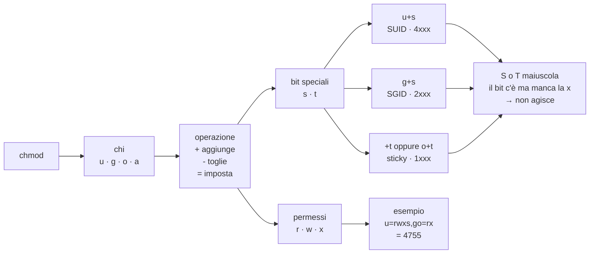

# Gestione di file, collegamenti e permessi

## 1. Componenti del filesystem Linux

La tabella nasce su Alpine: BusyBox, `mdev` e `apk` sono propri di quella distribuzione.
Su Rocky valgono `udev` e `dnf`, e le differenze di rilievo sono segnate nelle singole righe.

| Directory     | Significato |
|---------------|-------------|
| `bin`         | Binari essenziali per tutti gli utenti. Su Alpine spesso symlink a BusyBox; su Rocky `/bin` è un collegamento a `/usr/bin` |
| `boot`        | File di boot: kernel (`vmlinuz-*`), initramfs, config bootloader |
| `dev`         | File di device (device nodes), popolato dinamicamente da `mdev`/`udev` |
| `etc`         | File di configurazione di sistema: rete, utenti, servizi, gestore di pacchetti (`/etc/apk` su Alpine, `/etc/dnf` e `/etc/yum.repos.d` su Rocky), ecc. |
| `home`        | Home directory degli utenti non di sistema |
| `lib`         | Librerie condivise necessarie a `bin` e `sbin`. Su Rocky `/lib` è un collegamento a `/usr/lib`, come `/bin` e `/sbin` |
| `lost+found`  | Directory riservata da `fsck` per frammenti di file recuperati dopo controlli filesystem. Esiste sui filesystem ext2/3/4, creata da `mkfs`; **non esiste su XFS**, il filesystem predefinito di Rocky |
| `media`       | Punti di mount per dispositivi rimovibili (USB, CD) |
| `mnt`         | Punti di mount temporanei/manuali generici |
| `opt`         | Software di terze parti installato manualmente, fuori dal gestore di pacchetti (`apk` su Alpine, `dnf` su Rocky) |
| `proc`        | Filesystem virtuale: stato del kernel e dei processi (pseudo-fs, non su disco) |
| `root`        | Home directory dell'utente root |
| `run`         | Dati runtime volatili (PID, socket, lock file), azzerata ad ogni boot (tmpfs) |
| `sbin`        | Binari di sistema/amministrazione. Su Alpine spesso symlink a BusyBox; su Rocky `/sbin` è un collegamento a `/usr/sbin` |
| `srv`         | Dati serviti da servizi (es. contenuti http/ftp) |
| `sys`         | Filesystem virtuale: interfaccia verso kernel/driver (sysfs, pseudo-fs) |
| `tmp`         | File temporanei. Se venga svuotata al riavvio dipende dalla distribuzione: montata come tmpfs si svuota, altrimenti la ripulisce periodicamente `systemd-tmpfiles` |
| `usr`         | Gerarchia secondaria: programmi, librerie, dati condivisi non essenziali al boot |
| `usr/local`   | Software installato manualmente dall'amministratore, fuori dal gestore di pacchetti (`apk` su Alpine, `dnf` su Rocky) |
| `var`         | Dati variabili: log, cache, spool, stato dei servizi |

---

Nota tecnica: `proc` e `sys` non occupano spazio su disco, sono viste sul kernel montate a runtime.

## 2. Comandi principali del filesystem

| Concetto | Windows (`cmd`) | Linux |
|---|---|---|
| Dove sono | `cd` | `pwd` |
| Spostarsi | `cd <dir>` | `cd <dir>` |
| Alla home | `cd %USERPROFILE%` | `cd` |
| Separatore | `\` | `/` |
| Livello superiore | `cd ..` | `cd ..` |
| Livello corrente | `cd .` | `cd .` |

**Nota (Windows).** In `cmd` il solo `cd` **non cambia unità**: `cd D:\lavoro`
eseguito mentre il prompt è su `C:` cambia sì la directory corrente *di* `D:`,
ma lascia il prompt dov'era. Per spostarsi davvero serve `cd /d D:\lavoro`
(oppure il comando `D:` da solo, seguito da `cd \lavoro`). In Linux il problema
non esiste: l'albero delle directory è **unico** e i dischi non compaiono come
lettere, ma vengono innestati in un punto qualsiasi dell'albero (punto di
mount), per cui `cd` raggiunge qualunque percorso senza distinzioni.

---

| Operazione | Windows (`cmd`) | Linux |
|---|---|---|
| Elenco | `dir` | `ls`, `ls -l` |
| Crea directory | `md`, `mkdir` | `mkdir` |
| Rimuovi directory vuota | `rd` | `rmdir` |
| Rimuovi ricorsivamente | `rd /s` | `rm -r`(*) |
| Crea file vuoto | `copy nul: file` | `touch file` |
| Crea file con un testo | `echo "testo da inserire" > file` | `echo "testo da inserire" > file` |
| Accoda un testo ad file | `echo "testo da accodare" >> file` | `echo "testo da inserire" >> file` |
| Mostra un file | `type file` | `cat file` |
| Copia | `copy` | `cp` |
| Sposta | `move` | `mv` |
| Rinomina | `ren` | `mv` |
| Cancella | `del` | `rm` |
| Mostra struttura directory | `tree <nome_dir>` | `tree <nome_dir>` (**) |
| Mostra i dettagli relativi ad un file | - | `stat <nome_file>` |
| Mostra il tipo di file | esamina il suffisso | `file <nome_file>` |
| Pulisci schermo | `cls` | `clear` |

(*) `rm -rf` (f=force) è molto pericoloso, ricordarsi sempre di mettere i flag -i (=richiedi conferma/interactive) e -v (=verbose) per cui il comando completo per cancellare una gerarchia di directory e file è:
``` bash
rm -rvi <nome_directory>
```
(**) `tree` non è installato per default né su Alpine né su Rocky: va aggiunto
con `apk add tree` sulla prima e `dnf install tree` sulla seconda.

Esempio

`rm -rvi a` percorre la directory `a` e tutto il contenuto **chiedendo conferma
voce per voce**: nulla viene cancellato senza una risposta affermativa. È il
punto dell'esercizio — bastano un `n` e la gerarchia non si svuota, come mostra
la coda dell'estratto qui sotto.

```text
rm: descend into directory 'a'? y
rm: descend into directory 'a/c'? y
rm: descend into directory 'a/c/documenti'? y
rm: descend into directory 'a/c/documenti/relazioni'? y
rm: descend into directory 'a/c/documenti/relazioni/pdf'? y
rm: remove directory 'a/c/documenti/relazioni/pdf'? n
rm: remove directory 'a/c/documenti/relazioni'? y
rm: can't remove 'a/c/documenti/relazioni': Directory not empty
```

*(l'estratto si ferma qui, ma la sessione non è finita: `rm` risale l'albero e
chiede ancora conferma per `a/c/documenti`, `a/c` e `a`, che falliranno a loro
volta finché `pdf` resta al suo posto. Due letture da portare a casa: il `-i`
agisce **due volte** per ogni directory, prima per entrarci — «descend into» — e
poi per rimuoverla; e una directory non vuota non si cancella, per cui un solo
rifiuto in fondo alla gerarchia blocca tutti i livelli superiori.)*

## 3. File nascosti e formati di visualizzazione (`ls`)

In Unix, i file e le directory il cui nome inizia con un punto (`.`) sono
considerati **nascosti**: non compaiono in un `ls` semplice e sono tipicamente file
di configurazione o di sistema (es. `.bashrc`, `.ssh/`).

- `-a` (*all*): mostra anche i file nascosti.
- `-l` (*long*): formato esteso, con permessi, proprietario, dimensione e data.
- `-t`: ordina per data di modifica (dal più recente al meno recente). **Nota:** la  `t` sta per *time*, criterio di ordinamento.
- `-r` (*reverse*): inverte l'ordine di visualizzazione.
- `--color`: colora l'output distinguendo a colpo d'occhio directory, eseguibili, link simbolici, ecc.

```bash
ls -al
```
```text
drwxr-xr-x  4 manager manager 4096 Jul 20 09:12 .
drwxr-xr-x 12 root root 4096 Jul 18 18:03 ..
-rw-------  1 manager manager  312 Jul 19 21:47 .bash_history
-rw-r--r--  1 manager manager   30 Jul 16 11:46 file.txt
```

```bash
ls -latr
```
```text
total 16
-rw-r--r--  1 manager manager   30 Jul 16 11:46 file.txt
-rw-r--r--  1 manager manager    0 Jul 18 09:02 f1.txt
-rw-r--r--  1 manager manager    0 Jul 20 09:12 f2.txt
```
*(senza `-r`, `f2.txt` — l'ultimo modificato — comparirebbe in cima; con `-r` finisce
in fondo, utile perché resta vicino al prompt quando la lista è lunga)*

```bash
ls --color -l /etc
```
```text
drwxr-xr-x  2 root root 4096 Jul 10 08:00 ssh      # blu: directory
-rwxr-xr-x  1 root root 1204 Jul 10 08:00 profile   # verde: eseguibile
lrwxrwxrwx  1 root root   19 Jul 10 08:00 mtab → ../proc/self/mounts  # ciano: link
```

*(la dimensione di un link simbolico non è quella del file puntato: è la
**lunghezza in caratteri del percorso** che il link contiene. Qui `19`, quanti
sono i caratteri di `../proc/self/mounts`. Il valore è quindi un controllo
immediato di coerenza quando si legge un `ls -l`.)*

l'alternativa (più moderna) a ls è [eza](https://github.com/eza-community/eza)

---

## 4. Copiare, spostare e collegare i file

### 4.1 `cp` — copiare

`cp sorgente destinazione` copia un file. Le flag principali viste a lezione:

- `-v` (*verbose*): stampa a schermo l'operazione effettuata.
- `-a` (*archive*): copia ricorsivamente directory e sottodirectory preservando
  permessi, proprietario e timestamp originali — è la modalità usata per le vere
  copie di backup. Su distribuzioni con **SELinux** attivo (Rocky Linux lo monta di
  default), `-a` da solo non garantisce la conservazione del *contesto di sicurezza*
  SELinux del file: per una copia realmente identica in ogni attributo serve
  `--preserve=all`.
- `-i` (*interactive*): chiede conferma prima di sovrascrivere un file già esistente
  a destinazione.

```bash
cp -v sorgente.txt destinazione.txt
```
```text
'sorgente.txt' → 'destinazione.txt'
```

```bash
cp -a /home/manager/progetto /backup/progetto
```
```text
# nessun output (senza -v): la cartella "progetto" viene copiata con tutte le
# sottodirectory, permessi, proprietario e date originali intatti
```

```bash
cp -i file.txt salutation.txt out.txt prova.txt d3
```
```text
# i quattro file vengono copiati dentro d3; grazie a -i la conferma viene
# chiesta solo per quelli che a destinazione esistono già:
cp: overwrite 'd3/file.txt'? y
```

### 4.2 `mv` — spostare o rinominare

`mv` sposta e/o rinomina un file, e se la destinazione è nella stessa directory di fatto lo
rinomina.

```bash
mv -v a.txt aa.txt
```
```text
'a.txt' → 'aa.txt'
```

```bash
mv -v report.txt /home/manager/archivio/
```
```text
'report.txt' → '/home/manager/archivio/report.txt'
```

```bash
mv -v *.txt d2/
```
```text
'a.txt' → 'd2/a.txt'
'note.txt' → 'd2/note.txt'
```

### 4.3 `ln` — collegamenti (hard link e link simbolici)

`ln` crea un **collegamento** tra un nome e i dati effettivamente presenti sul
disco. A differenza di `cp`, **non duplica i dati**: crea solo un ulteriore modo
per raggiungerli (o, nel caso del link simbolico, un riferimento al percorso).

I due tipi di collegamento non sono intercambiabili, e la differenza non è solo
di implementazione: il link simbolico è libero, l'hard link è soggetto a due
vincoli che vanno conosciuti prima di usarlo.

- **Link simbolico** (`ln -s`): un file speciale che contiene semplicemente il
  *percorso* verso un altro file **oppure directory**. Può attraversare i
  filesystem e può perfino puntare a un percorso che non esiste (link "rotto"),
  perché il percorso viene risolto al momento dell'uso, non della creazione.
  `ls -l link_name_to_file` mostra gli attributi del
  link stesso (tipo `l`, con una freccia `→` verso il target); `ls -l link_name_to_file/`, se il
  target è una directory, ne mostra il contenuto.
- **Hard link** (`ln`, senza `-s`): crea un secondo nome che punta esattamente allo
  stesso inode (la stessa area dati) del file originale. Dal punto di vista del
  filesystem, i due nomi sono equivalenti: non esiste un "originale" e una "copia".
  Proprio perché il riferimento è l'inode, e non il percorso, valgono due limiti:
  - **solo su file, non su directory**: `ln una_dir altra_dir` viene rifiutato
    (`hard link not allowed for directory`). Gli unici hard link a directory
    sono `.` e `..`, creati dal filesystem stesso; concederli all'utente
    permetterebbe di costruire cicli nell'albero, che gli strumenti di
    attraversamento (`find`, `rm -r`, `du`) non saprebbero chiudere.
  - **solo all'interno dello stesso filesystem**: il numero di inode ha
    significato unicamente nel filesystem che lo contiene, quindi un hard link
    non può scavalcare un punto di mount (`Invalid cross-device link`). Il link
    simbolico, che memorizza un percorso testuale, non ha questo limite.

  Quanti nomi puntino a un dato inode è il contatore della **seconda colonna**
  di `ls -l`: vale `1` per un file con un solo nome, `2` per i due nomi
  dell'esempio qui sotto.

```bash
ln -sv /home/manager/d2 link
ls -l link
```
```text
'link' → '/home/manager/d2'
lrwxrwxrwx 1 manager manager 16 Jul 20 10:00 link → /home/manager/d2
```

```bash
echo "Hello world" > file.txt
ln -sv file.txt link-to-file.txt
cat link-to-file.txt
rm file.txt
cat link-to-file.txt
```
```text
'link-to-file.txt' → 'file.txt'
Hello world
cat: link-to-file.txt: No such file or directory
```
*(rimuovendo il link simbolico, `file.txt` resta intatto e leggibile; rimuovendo
invece il file originale, il link diventa "rotto" — punta a un percorso che non
esiste più — perché conteneva solo un riferimento, non i dati)*

```bash
echo "hola mundo" > saluti.txt
ln -v saluti.txt salutation.txt
echo "ciao mondo" >> saluti.txt
rm saluti.txt
cat salutation.txt
```
```text
'salutation.txt' => 'saluti.txt'
hola mundo
ciao mondo
```

### lavorare con Owner e Gruppi

#### chgrp
`chgrp groupname filename` cambia il gruppo di un file.

#### chown
`chown user:group filename` cambia proprietario e/o gruppo.

`chown user` cambia solo il proprietario.
`chown :group` cambia solo il gruppo.
`chown user:group` cambia sia proprietario che gruppo.

**Solo root può cambiare il proprietario.**
Un utente normale può cambiarne soltanto il gruppo, e solo se il file è suo
ed il gruppo di destinazione è uno dei gruppi a cui appartiene.

---

## Permessi di default

sapendo che il permesso di default di linux nella creazione delle directory é **777**
e che il permesso di default per la creazione dei file è **666**

perché quanto segue? (directory=755 file=644) delta apparente di 022?

```text
touch a.txt
-rw-r--r-- 1 manager manager    0 Sep 23 11:20  a.txt
```
quindi
U => rw => 4+2=6
G => r => 4
O => r => 4

```text
mkdir dirprova
drwxr-xr-x 2 manager manager 4096 Sep 23 11:22 dirprova/
```
quindi
U => rwx => 4+2+1=7
G => rx => 4+1=5
O => rx => 4+1=5

Le sezioni che seguono riscrivono in forma lineare il materiale su `umask`, applicando l'algebra di Boole nel modo corretto.

## Umask e algebra di Boole

### 1. Permessi Unix

I permessi Unix sono 9 bit, divisi in tre gruppi:

```text
rwx rwx rwx
proprietario gruppo altri
```

Ogni permesso vale:

```text
r = 4
w = 2
x = 1
```

Quindi una cifra ottale da `0` a `7` rappresenta una terzina:

```text
0 = ---
1 = --x
2 = -w-
3 = -wx
4 = r--
5 = r-x
6 = rw-
7 = rwx
```

I permessi di partenza sono:

- file: `666` → `rw- rw- rw-`
- directory: `777` → `rwx rwx rwx`

La `umask` non è una sottrazione aritmetica. È una maschera di bit che indica quali permessi **disattivare** nei permessi di default.

---

### 2. Notazione ottale e binaria

| Ottale | Binario |
|---|---|
| 0 | 000 |
| 1 | 001 |
| 2 | 010 |
| 3 | 011 |
| 4 | 100 |
| 5 | 101 |
| 6 | 110 |
| 7 | 111 |

Per i permessi si usano solo cifre da `0` a `7`.

---

### 3. Algebra di Boole minima

#### NOT

| A | NOT A |
|---|---|
| 0 | 1 |
| 1 | 0 |

#### AND

| A | B | A AND B |
|---|---|---|
| 0 | 0 | 0 |
| 0 | 1 | 0 |
| 1 | 0 | 0 |
| 1 | 1 | 1 |

#### OR

| A | B | A OR B |
|---|---|---|
| 0 | 0 | 0 |
| 0 | 1 | 1 |
| 1 | 0 | 1 |
| 1 | 1 | 1 |

Per `umask` servono soprattutto `NOT` e `AND`.

---

### 4. Formula corretta

```text
permessi_finali = permessi_base AND NOT(umask)
```

In notazione da shell/C:

```text
base & ~umask
```

Spiegazione:

- dove `umask` ha `1`, `NOT(umask)` ha `0`, quindi `AND` spegne quel permesso;
- dove `umask` ha `0`, `NOT(umask)` ha `1`, quindi `AND` lascia il bit di base com’è.

---

### 5. Esempi per i file

Base file: `666` = `110 110 110` = `rw- rw- rw-`

#### umask 022

```text
base         666   110 110 110   rw- rw- rw-
umask        022   000 010 010

NOT(umask)   755   111 101 101 AND
base         666   110 110 110
            ------------------------
Risultato    655   110 100 100   rw- r-- r--
```

Risultato: `644`

#### umask 027

```text
base   666   110 110 110   rw- rw- rw-
umask  027   000 010 111
NOT    750   111 101 000
AND          110 100 000   rw- r-- ---
```

Risultato: `640`

#### umask 033

```text
base   666   110 110 110   rw- rw- rw-
umask  033   000 011 011
NOT    744   111 100 100
AND          110 100 100   rw- r-- r--
```

Risultato: `644`

Qui la sottrazione aritmetica darebbe:

```text
666 - 033 = 633
```

ma il risultato corretto è `644`. Quindi la sottrazione non è il meccanismo: a volte coincide, ma non è garantito.

---

### 6. Esempi per le directory

Base directory: `777` = `111 111 111` = `rwx rwx rwx`

#### umask 022

```text
777 & ~022 = 755
```

#### umask 027

```text
777 & ~027 = 750
```

#### umask 002

```text
777 & ~002 = 775
```

---

### 7. Comandi utili

```bash
umask                # mostra la umask corrente
umask 022            # imposta la umask a 022
umask 027            # imposta la umask a 027
```

Verifica del calcolo:

```bash
printf "%o\n" $((0666 & ~0022))   # 644
printf "%o\n" $((0777 & ~0022))   # 755
```

Nota: in shell `~` è il NOT bit a bit. Poiché poi si fa `AND` con `0666` o `0777`, i bit eccedenti vengono ignorati.

---

### 8. Riassunto

- La `umask` non si sottrae: si applica con `AND NOT`.
- Formula: `permessi_finali = permessi_base AND NOT(umask)`.
- Base file: `666`.
- Base directory: `777`.
- La umask predefinita è spesso `022`, ma può essere `002` o altro.
- Il valore effettivo si legge con `umask`, non si presume.

#### permessi/caratteristiche aggiuntive

##### `4` = suid
esegui con l'utente del proprietario

utente X, gruppo K crea un eseguibile AAA con privilegi 4755 suid=on,u:rwx,g:rx,o:rx
succede che se AAA viene eseguito dall'utente T gruppo Z, durante l'esecuzione il processo assume l'**UID effettivo di X**;
il gruppo resta Z. Assumere anche il gruppo K è il compito di sgid (sotto).

Linux **ignora suid e sgid sugli script** interpretati (`man 2 execve`): valgono solo sui programmi compilati.

Provato su Rocky il 2026-09-17, copia di `id` di proprietà `ua:grp01`, eseguita da `uc`:

```text
4755  uid=1004(uc) gid=1005(uc) euid=1002(ua) groups=1005(uc)
6755  uid=1004(uc) gid=1005(uc) euid=1002(ua) egid=1002(grp01) groups=1002(grp01),1005(uc)
```

##### `2` = sgid
ha due significati, secondo il tipo di voce.

- **Sulle directory: eredità del gruppo.** Se `sgid` è settato sulla directory i file creati prendono il gruppo della cartella, altrimenti prendono il gruppo dell'utente creatore.
- **Sui file eseguibili:** il processo assume il **GID effettivo** del gruppo del file (riga `6755` della prova sopra: `egid=1002(grp01)`).

##### `1` = sticky
vale **sulle directory**: in una directory con lo sticky bit un file può essere cancellato o rinominato solo
dal proprietario del file, dal proprietario della directory o da root, anche se la directory è scrivibile da tutti.
È il caso di `/tmp`: `drwxrwxrwt`. Su un file regolare Linux lo ignora (`man 1 chmod`).

## `chmod` in forma simbolica e i bit speciali

### La sintassi

`chmod <chi><operazione><permessi> <file>`

| Parte | Simbolo | Significato |
|---|---|---|
| **chi** | `u` | proprietario |
| | `g` | gruppo |
| | `o` | altri |
| | `a` | tutti e tre |
| **operazione** | `+` | aggiunge |
| | `-` | toglie |
| | `=` | imposta esattamente, togliendo il resto |
| **permessi** | `r` · `w` · `x` | lettura · scrittura · esecuzione |
| **bit speciali** | `s` · `t` | vedi la tabella seguente |

### I bit speciali

| Bit | Simbolico | Numerico | Dove ha senso | In `ls -l` |
|---|---|---|---|---|
| SUID | `u+s` | `4xxx` | programmi compilati; sugli script Linux lo ignora | `s` al posto della `x` del proprietario |
| SGID | `g+s` | `2xxx` | directory condivise, programmi | `s` al posto della `x` del gruppo |
| sticky | `+t` oppure `o+t` | `1xxx` | directory condivise | `t` al posto della `x` degli altri |

### Esempi

| Comando | Equivale a |
|---|---|
| `chmod u=rwxs,go=rx file` | `chmod 4755 file` |
| `chmod g+s dir` | aggiunge `2000` ai permessi di `dir` |
| `chmod +t dir` | aggiunge `1000` ai permessi di `dir` |
| `chmod u-s file` | toglie il SUID |
| `chmod g-s,o-t dir` | toglie SGID e sticky |

⚠️ **`S` o `T` maiuscola** in `ls -l`: il bit è impostato ma manca la `x` sotto
di esso, e il bit non agisce. Si aggiunge la `x` corrispondente: `chmod u+x`,
`g+x`, `o+x`.

### Lo schema



### La dimostrazione fatta in aula

Il SUID su uno script non agisce; su un programma compilato sì. Misurato in aula
il 2026-09-23: `/a.txt` creato da `manager` risulta di `root`.

```
sudo cp /usr/bin/touch /usr/local/bin/touch-suid
sudo chmod u+s /usr/local/bin/touch-suid
printf '#!/bin/bash\n/usr/local/bin/touch-suid /a.txt\nls -l /a.txt\n' > ~/prova.sh
chmod +x ~/prova.sh
~/prova.sh
sudo rm /usr/local/bin/touch-suid /a.txt ~/prova.sh
```

### permessi speciali ==> SGID (chmod g+s chmod 2xxx)

```bash
id manager # uid=1000(manager) gid=1000(manager) groups=1000(manager),10(wheel),2002(administrator),2004(adminshare)
id admin # uid=2001(admin) gid=2001(admin) groups=2001(admin),10(wheel),2004(adminshare)

# gli utenti condividono l'appartenenza al gruppo 2004 (adminshare)
sudo mkdir -pv /condivisione # crea una directory da condividere tra manager e admin
ls -ld /condivisione # drwxr-xr-x. 2 root root 6 Oct  2 15:39 /condivisione/
sudo chown :adminshare /condivisione # oppure sudo chgrp -v /condivisione
sudo chmod 770 /condivisione # apre scrittura al gruppo
ls -ld /condivisione # drwxrwx---. 2 root adminshare 6 Oct  2 15:39 /condivisione/

# admin tenta di creare un file in /home/manager/condivisione
touch /condivisione/prova.txt # success
# manager crea un file a propria volta
touch /condivisione/prova2.txt # success

ls -l /condivisione/
# total 0
# -rw-r--r--. 1 manager manager 0 Oct  2 16:09 prova2.txt
# -rw-r--r--. 1 admin   admin   0 Oct  2 16:09 prova.txt

sudo chmod -Rv g+w /condivisione/
# mode of '/condivisione/' retained as 0770 (rwxrwx---)
# mode of '/condivisione/prova.txt' changed from 0644 (rw-r--r--) to 0664 (rw-rw-r--)
# mode of '/condivisione/prova2.txt' changed from 0644 (rw-r--r--) to 0664 (rw-rw-r--)
# 
ls -l /condivisione/ # i gruppi sono diversi quindi è impossibile la modifica incrociata

sudo chown -Rv :adminshare /condivisione
# changed ownership of '/condivisione/prova.txt' from admin:admin to :adminshare
# ownership of '/condivisione/prova2.txt' retained as manager:adminshare
# ownership of '/condivisione' retained as root:adminshare

# problema tutte le volte che uno user crea un file su /condivisione
# il file viene creato con user:group del creatore
# invece sarebbe auspicabile ottenere il gruppo della directory ==> adminshare
sudo chmod g+s /condivisione/ # ovvero sudo chmod 2770 /condivisione/

# test gruppo da manager
touch /condivisione/prova4.txt
ls -l /condivisione # il gruppo è stato applicato correttamente
```

```text
total 4
# ...
# -rw-r--r--. 1 manager adminshare  0 Oct  2 16:24 prova4.txt
# ...
```

### Precedenza tra proprietario, gruppo e altri

Il sistema non somma le tre terne. Sceglie **una sola** classe, in questo ordine:

1. se l'utente è il proprietario, applica i permessi dell'utente;
2. altrimenti, se appartiene al gruppo proprietario o a un gruppo supplementare che coincide, applica i permessi del gruppo;
3. altrimenti applica i permessi degli altri.

Per esempio, con `-rwxr-xrwx`, un utente che appartiene al gruppo proprietario usa `r-x`, anche se la terna «altri» contiene `rwx`. L'appartenenza al gruppo quindi non concede anche i permessi più larghi destinati agli altri.
