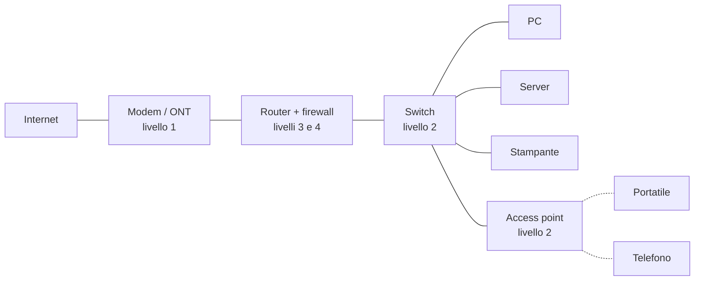

# Dispositivi di rete: che cosa sono, a che livello lavorano, a che cosa servono

## 1. Prima dei dispositivi: l'idea di «livello»

Una comunicazione in rete è **troppo complessa per essere trattata come un
problema unico**, e per questo viene divisa in **livelli** (o strati). Ogni
livello risolve un problema solo e si appoggia a quello sottostante, senza
preoccuparsi di come quest'ultimo faccia il suo lavoro.

Un paragone è la posta. Chi scrive una lettera pensa al contenuto;
la busta porta un indirizzo; l'ufficio postale legge soltanto il CAP e la
città; il furgone trasporta sacchi senza sapere che cosa contengono. Ognuno
guarda soltanto l'informazione che gli serve.

Il modello di riferimento è l'**ISO/OSI**, a sette livelli. Per i dispositivi
di rete ne contano in pratica quattro, più l'ultimo:

| Livello | Nome | Che cosa trasporta | Come identifica il destinatario | Esempio |
|:---:|---|---|---|---|
| 1 | Fisico | bit (segnali elettrici, luce, onde radio) | non lo identifica: il segnale va a tutti quelli collegati | cavo di rame, fibra, Wi-Fi come onda radio |
| 2 | Collegamento (data link) | **frame** | **indirizzo MAC** — scritto nella scheda di rete, vale solo nella rete locale `ip -br link` | Ethernet, Wi-Fi  |
| 3 | Rete | **pacchetti** | **indirizzo IP** — vale da una rete all'altra, fino all'altro capo del mondo ``ip -br addr`` | IPv4, IPv6 |
| 4 | Trasporto | **segmenti** | **porta** — individua il programma sulla macchina di destinazione `less /etc/services` ad esempio il web server sulla porta 80 | TCP, UDP |
| 7 | Applicazione | i dati veri e propri | nomi, indirizzi web, utenti | HTTP, DNS, SSH, posta |

I livelli 5 e 6 (sessione e presentazione) esistono nel modello ma non
corrispondono a dispositivi distinti: nella pratica vengono assorbiti
nel livello 7.

**La regola per leggere il resto della scheda.** Dire che un dispositivo
«lavora a livello N» significa che legge le informazioni fino a quel livello
e non oltre. Uno switch (livello 2) legge l'indirizzo MAC e ignora l'IP; un
router (livello 3) legge l'IP e ignora la porta; un firewall (livello 4)
legge anche la porta. Più alto è il livello, più il dispositivo «capisce» di
ciò che sta trasportando — e più lavoro deve fare per ogni dato che passa.

---

## 2. Il quadro d'insieme

| Dispositivo | Livello | Che cosa guarda | A che cosa serve, in una riga |
|---|:---:|---|---|
| Cavo, fibra, connettori | 1 | niente | trasportano il segnale |
| Ripetitore (repeater) | 1 | niente | rigenera il segnale per allungare la tratta |
| Hub | 1 | niente | replica il segnale su tutte le porte (obsoleto) |
| Modem / ONT | 1 | niente | adatta il segnale alla linea dell'operatore |
| Convertitore di mezzo (media converter) | 1 | niente | passa da rame a fibra e viceversa |
| Scheda di rete (NIC) | 1–2 | MAC | collega un computer alla rete |
| Bridge | 2 | MAC | unisce due segmenti di rete locale |
| Switch | 2 | MAC | collega fra loro i dispositivi di una rete locale |
| Access point (AP) | 2 | MAC | porta la rete locale nell'aria (Wi-Fi) |
| Router | 3 | IP | collega reti diverse e sceglie il percorso |
| Switch di livello 3 | 2–3 | MAC e IP | switch che sa anche instradare fra reti interne |
| Firewall | 3–4 (fino a 7) | IP, porta, a volte il contenuto | decide che cosa può passare e che cosa no |
| Bilanciatore di carico (load balancer) | 4 o 7 | porta, oppure la richiesta | distribuisce le richieste su più server |
| Proxy / reverse proxy | 7 | la richiesta applicativa | fa da intermediario fra client e server |
| IDS / IPS | 3–7 | tutto il traffico | rileva (IDS) o blocca (IPS) traffico sospetto |
| Concentratore VPN | 3 | IP | crea un tunnel cifrato fra reti o utenti lontani |
| Gateway | — | — | termine generico: «la porta d'uscita» (vedi §7) |

---

## 3. Livello 1 — chi trasporta il segnale senza capirlo

I dispositivi di livello 1 non leggono nulla. Trattano elettricità, luce o
onde radio: ciò che entra da una parte esce dall'altra, senza alcuna
decisione.

**Cavi e fibra.** Il cavo di rame intrecciato (quello con il connettore
RJ45, detto impropriamente «cavo Ethernet») copre fino a circa 100 metri.
La fibra ottica trasporta luce anziché elettricità, copre chilometri e non
soffre i disturbi elettrici.

**Ripetitore.** Un segnale si indebolisce con la distanza. Il ripetitore lo
riceve, lo rigenera e lo ritrasmette, allungando la tratta. I «ripetitori
Wi-Fi» domestici svolgono lo stesso compito sulle onde radio.

**Hub.** È un ripetitore con molte porte: ciò che arriva su una porta viene
copiato su tutte le altre. Ne derivano due difetti. Tutti ricevono tutto,
anche ciò che non li riguarda; e se due macchine trasmettono insieme i
segnali si sovrappongono e vanno persi (**collisione**). L'hub è stato
sostituito dallo switch e oggi non si incontra più, ma serve conoscerlo per
capire che cosa lo switch ha migliorato.

**Modem e Optical Network Tterminal** La linea dell'operatore (doppino telefonico, cavo coassiale,
fibra) usa segnali diversi da quelli della rete di casa o d'ufficio. Il
modem — che nelle linee in fibra prende il nome di ONT — traduce gli uni
negli altri. Il nome viene da *modulatore-demodulatore*.

**Convertitore di mezzo.** Una scatoletta con una porta in rame e una in
fibra: serve a collegare due tratti realizzati con cavi diversi.

---

## 4. Livello 2 — la rete locale e gli indirizzi MAC

A questo livello compare il primo indirizzo: il **MAC**. È un numero di 48
bit assegnato alla scheda di rete in fabbrica, scritto in esadecimale, per
esempio `52:54:00:a1:b2:c3`. Vale soltanto all'interno della rete locale
(**LAN**): serve a consegnare un frame alla macchina giusta fra quelle
collegate allo stesso tratto di rete.

**Scheda di rete (NIC).** È il componente che collega un computer alla rete,
via cavo o via radio. Sta a cavallo fra livello 1 e 2: genera il segnale
fisico e, insieme, possiede l'indirizzo MAC con cui la macchina si presenta.
Un computer può averne più di una, e in tal caso ha più indirizzi MAC.

**Switch.** È il dispositivo centrale di ogni rete locale. Esteriormente
somiglia a un hub — una scatola con molte porte — ma si comporta in modo
opposto: **impara** quale indirizzo MAC sta dietro a ciascuna porta,
osservando i frame che riceve, e li annota in una tabella. Da quel momento
un frame destinato a una macchina esce **soltanto** dalla porta a cui quella
macchina è collegata. Niente collisioni, niente traffico recapitato a chi
non c'entra.

Gli switch più evoluti (detti *gestiti*, o *managed*) permettono inoltre di
dividere le porte in gruppi separati, le **VLAN**: un unico apparecchio
fisico si comporta come più switch indipendenti, per esempio uno per gli
uffici e uno per gli ospiti.

**Bridge.** È il progenitore dello switch: unisce due segmenti di rete
locale e lascia passare dall'uno all'altro soltanto i frame che devono
effettivamente attraversare. Uno switch è, in sostanza, un bridge con molte
porte. Come apparecchio fisico è scomparso, ma il concetto è vivissimo nel
software: su Linux un bridge è il modo normale di collegare alla rete le
macchine virtuali e i container.

**Access point (AP).** Fa per il Wi-Fi ciò che lo switch fa per i cavi:
collega i dispositivi senza fili alla rete locale. Da un lato parla via
radio, dall'altro è collegato con un cavo allo switch. Non va confuso con il
router: un access point puro non instrada nulla, estende soltanto la rete
locale nell'aria.

---

## 5. Livello 3 — da una rete all'altra, con gli indirizzi IP

L'indirizzo MAC basta finché mittente e destinatario stanno nella stessa
rete locale. Per raggiungere una rete diversa serve un indirizzo che abbia
senso ovunque: l'**indirizzo IP**, per esempio `192.168.1.20`. A differenza
del MAC non è legato all'hardware: viene assegnato, e dice **in quale rete**
si trova la macchina.

**Router.** Collega reti diverse. Ha almeno due interfacce, ciascuna in una
rete, e per ogni pacchetto che riceve legge l'IP di destinazione, consulta la
propria **tabella di instradamento** (*routing table*) e decide da quale
interfaccia farlo uscire. Internet è, in fondo, una catena lunghissima di
router che si passano i pacchetti l'uno all'altro, ciascuno conoscendo
soltanto il passo successivo.

La differenza fra switch e router è il punto che più conviene fissare:

| | Switch | Router |
|---|---|---|
| Livello | 2 | 3 |
| Legge | indirizzo MAC | indirizzo IP |
| Collega | macchine **della stessa rete** | reti **diverse** |
| Tabella | MAC → porta (imparata da solo) | rete → interfaccia (configurata o appresa da altri router) |

Quasi tutti i router svolgono anche il **NAT**: sostituiscono gli indirizzi
privati della rete interna con l'unico indirizzo pubblico ricevuto
dall'operatore, in modo che molte macchine possano uscire su Internet
condividendo un solo indirizzo.

**Switch di livello 3.** È uno switch che sa anche instradare. Si usa nelle
reti aziendali per far comunicare fra loro le VLAN interne ad alta velocità,
senza passare da un router separato.

**Concentratore VPN.** Crea un **tunnel cifrato** attraverso Internet, così
che due sedi lontane — oppure un utente da casa e la rete dell'ufficio — si
vedano come se fossero nella stessa rete privata. Spesso non è un apparecchio
a sé ma una funzione del router o del firewall.

---

## 6. Livello 4 e oltre — chi guarda che cosa sta passando

Salendo, i dispositivi non si limitano più a recapitare: **scelgono** in base
al tipo di traffico. Al livello 4 compare la **porta**, un numero che
individua il servizio sulla macchina di destinazione: 22 per SSH, 80 per
HTTP, 443 per HTTPS.

**Firewall.** Sta sul confine fra due reti — tipicamente fra la rete interna
e Internet — e applica un elenco di regole per decidere che cosa passa. Le
regole classiche si esprimono con indirizzi IP e porte: «dall'esterno si può
raggiungere soltanto la porta 443 del server web», «dall'interno si può
uscire verso qualunque destinazione». I firewall moderni tengono inoltre
traccia delle connessioni aperte (*stateful*), così da riconoscere le
risposte a richieste legittime. Quelli detti *di nuova generazione* (NGFW)
arrivano al livello 7 ed esaminano il contenuto: distinguono, per esempio,
una vera navigazione web da un altro programma che usa la stessa porta.

Un firewall può essere un apparecchio dedicato oppure un software sulla
singola macchina: su Linux è `firewalld` (o `nftables`), e protegge il
sistema su cui gira.

**Bilanciatore di carico.** Quando un servizio è erogato da più server
identici, il bilanciatore riceve tutte le richieste e le distribuisce fra di
essi, escludendo quelli che non rispondono. Può lavorare a livello 4
(smista le connessioni guardando soltanto IP e porta) oppure a livello 7
(legge la richiesta e decide in base al suo contenuto, per esempio
l'indirizzo della pagina).

**Proxy e reverse proxy.** Un proxy è un intermediario a livello 7: riceve
la richiesta, la comprende, e la ripete per conto di chi l'ha fatta.

- Il **proxy** (diretto) sta dalla parte dei client: gli utenti di una rete
  passano da lui per uscire su Internet. Permette di filtrare, registrare e
  conservare copie delle pagine più richieste.
- Il **reverse proxy** sta dalla parte dei server: chi arriva da fuori parla
  con lui, ed è lui a inoltrare la richiesta al server interno appropriato.
  Nginx e HAProxy sono impiegati comunemente in questo ruolo.

**IDS e IPS.** Osservano il traffico alla ricerca di comportamenti noti
come ostili. L'IDS (*Intrusion Detection System*) si limita a segnalare;
l'IPS (*Intrusion Prevention System*) è attraversato dal traffico e può
bloccarlo.

---

## 7. Una parola che genera confusione: «gateway»

*Gateway* non indica un tipo di apparecchio ma un **ruolo**: il punto da cui
si esce da una rete per andare altrove. Nella configurazione di un computer,
il **gateway predefinito** (*default gateway*) è l'indirizzo IP del router a
cui consegnare tutti i pacchetti destinati fuori dalla rete locale. Se il
gateway è sbagliato o irraggiungibile, la macchina parla con i vicini ma non
esce su Internet: è uno dei guasti più frequenti.

---

## 8. Il «router di casa» non è soltanto un router

L'apparecchio fornito dall'operatore viene chiamato «router» o «modem», ma
racchiude in un'unica scatola quasi tutti i dispositivi descritti finora:

| Funzione | Livello | Che cosa fa nella scatola |
|---|:---:|---|
| Modem / ONT | 1 | parla con la linea dell'operatore |
| Switch | 2 | le quattro porte gialle sul retro |
| Access point | 2 | il Wi-Fi |
| Router con NAT | 3 | collega la rete di casa a Internet |
| Firewall | 3–4 | blocca le connessioni non richieste dall'esterno |
| Server DHCP | 7 | assegna automaticamente gli indirizzi IP ai dispositivi |
| Inoltro DNS | 7 | traduce i nomi dei siti in indirizzi IP |

DHCP e DNS non sono dispositivi ma **servizi**: programmi in esecuzione su
una macchina della rete. Compaiono qui perché senza di essi una rete
funzionerebbe soltanto configurando ogni cosa a mano.

In una rete aziendale le stesse funzioni sono svolte da apparecchi separati,
ed è lì che conviene saperle distinguere.

---

## 9. Una piccola rete, tutta insieme



Le linee continue sono cavi, quelle tratteggiate collegamenti Wi-Fi.

**Che cosa succede quando il PC apre un sito web.**

1. Il PC si accorge che l'indirizzo di destinazione **non** appartiene alla
   propria rete, e quindi affida il pacchetto al gateway predefinito, cioè
   al router.
2. Il frame attraversa lo **switch**, che guarda soltanto il MAC del router
   e lo fa uscire dalla porta giusta.
3. Il **router** legge l'IP di destinazione, applica il NAT e decide di
   inoltrare il pacchetto verso l'esterno; il **firewall** verifica che la
   connessione sia ammessa.
4. Il **modem** converte il tutto nel segnale adatto alla linea
   dell'operatore.
5. Da lì in avanti il pacchetto passa di router in router fino al server
   di destinazione. La risposta percorre la strada inversa.

**Che cosa succede quando il PC stampa.** La stampante è nella stessa rete:
il frame va dal PC allo switch e dallo switch alla stampante. Il router non
viene interpellato.

---

## 10. Dove si vede tutto questo da una macchina Linux

Ogni livello ha un comando che ne mostra lo stato. Servono per osservare,
non modificano nulla.

| Livello | Comando | Che cosa mostra |
|:---:|---|---|
| 1–2 | `ip link` | le schede di rete, il loro indirizzo MAC, se il collegamento è attivo (`UP`) |
| 2 | `ip neigh` | i MAC delle macchine vicine già conosciute (tabella ARP) |
| 3 | `ip addr` | gli indirizzi IP assegnati a ciascuna scheda |
| 3 | `ip route` | la tabella di instradamento; la riga `default via …` è il gateway |
| 4 | `ss -tuln` | le porte TCP e UDP su cui la macchina è in ascolto |
| 7 | `resolvectl status` oppure `cat /etc/resolv.conf` | i server DNS [DNS](https://it.wikipedia.org/wiki/Domain_Name_System)** in uso |

per interrogare il dns utilizzare:
`nslookup`
`dig nome@server`

Seguire i livelli dal basso verso l'alto è anche il metodo corretto per
cercare un guasto: il cavo è collegato? c'è un indirizzo IP? il gateway
risponde? il nome viene risolto? Ogni domanda ha senso soltanto se la
precedente ha avuto risposta affermativa.

---

## 11. In sintesi

- **Livello 1** — cavi, hub, ripetitori, modem: trasportano il segnale, non
  leggono nulla.
- **Livello 2** — switch, bridge, access point: leggono il **MAC**, lavorano
  **dentro** una rete locale.
- **Livello 3** — router: leggono l'**IP**, collegano reti **diverse**.
- **Livello 4** — firewall, bilanciatori: leggono anche la **porta**,
  decidono in base al servizio.
- **Livello 7** — proxy, firewall evoluti, bilanciatori applicativi:
  comprendono il **contenuto** della richiesta.
- **Gateway** è un ruolo, non un apparecchio; il **«router di casa»** è molti
  apparecchi in una scatola sola.

## minimo di debugging

### verificare la connettività  

```bash
ping 127.0.0.1 # verifica stack ip
ping localhost #  verifica stack ip + verifica nome host
cat /etc/hosts # stampa del file di configurazione base del TCP/IP

ping 1.1.1.1 # verifica connettivita esterna ==> funziona la rete? pimg DNS di cloudflare
ping one.one.one.one # verifica connettivita esterna + risoluzione nomi ==> funziona la rete?
```

### verifica connettività + routing

stabilire il percorso che i pacchetti fanno nella rete

```bash
sudo traceroute <host_ip>|<host_name> # versione unix
tracert <host_ip>|<host_name> # versione windows da lanciare da una shell administrator
```

**prima ricerca** `sudo traceroute 1.1.1.1`
```text
traceroute to 1.1.1.1 (1.1.1.1), 30 hops max, 60 byte packets
 1  _gateway (172.16.10.2)  0.152 ms  0.091 ms  0.134 ms
 2  _gateway (192.168.1.1)  0.549 ms  0.508 ms  0.579 ms
 3  * * * (timeout/ignorata)
 4  10.128.71.29 (10.128.71.29)  42.642 ms  42.504 ms  42.462 ms
 5  10.128.71.14 (10.128.71.14)  42.367 ms  42.312 ms  42.219 ms
 6  10.128.71.236 (10.128.71.236)  42.187 ms  42.651 ms  42.516 ms
 7  10.128.71.1 (10.128.71.1)  55.508 ms  55.518 ms  48.840 ms
 8  185.210.48.66 (185.210.48.66)  55.338 ms  55.282 ms  55.227 ms
 9  185.210.48.67 (185.210.48.67)  55.316 ms  55.133 ms  55.096 ms
10  188.114.100.19 (188.114.100.19)  55.180 ms 188.114.100.31 (188.114.100.31)  54.989 ms  53.091 ms
11  one.one.one.one (1.1.1.1)  40.229 ms  52.900 ms  38.613 ms
```


**seconda ricerca** `traceroute one.one.one.one` notare il cambio di rotta
```text
traceroute to one.one.one.one (1.1.1.1), 30 hops max, 60 byte packets
 1  _gateway (172.16.10.2)  1.182 ms  1.120 ms  1.065 ms
 2  _gateway (192.168.1.1)  0.506 ms  0.409 ms  0.396 ms
 3  * * *
 4  10.128.71.29 (10.128.71.29)  37.155 ms  37.149 ms  37.090 ms
 5  10.128.71.14 (10.128.71.14)  37.046 ms  36.976 ms  36.931 ms
 6  10.128.71.236 (10.128.71.236)  36.901 ms  41.205 ms  46.966 ms
 7  10.128.71.1 (10.128.71.1)  46.936 ms  46.873 ms  46.775 ms
 8  185.210.48.66 (185.210.48.66)  46.716 ms  39.727 ms  46.088 ms
 9  185.210.48.67 (185.210.48.67)  46.013 ms  39.407 ms  45.872 ms
10  188.114.100.43 (188.114.100.43)  45.766 ms 188.114.100.31 (188.114.100.31)  45.714 ms 188.114.100.19 (188.114.100.19)  71.519 ms
11  one.one.one.one (1.1.1.1)  45.566 ms  45.494 ms  39.706 ms
```

### Lavorare con la schede di rete

`ip a` mostra indirizzi di rete e netmask associati
`ip -br a` mostra indirizzi di rete e netmask associati (-br ==> brief)
`ss -tuln` quali sono le porte TCP e UDP in ascolto (quali sono i server attivi?)


`ss -tuln`
```text
Netid       State        Recv-Q       Send-Q                             Local Address:Port                Peer Address:Port       
udp         UNCONN       0            0                                      127.0.0.1:323                      0.0.0.0:*          
udp         UNCONN       0            0                                        0.0.0.0:41641                    0.0.0.0:*          
udp         UNCONN       0            0                                          [::1]:323                         [::]:*          
udp         UNCONN       0            0                                           [::]:41641                       [::]:*          
tcp         LISTEN       0            128                                      0.0.0.0:22                       0.0.0.0:*          
tcp         LISTEN       0            4096                               100.111.57.57:53437                    0.0.0.0:*          
tcp         LISTEN       0            128                                         [::]:22                          [::]:*          
tcp         LISTEN       0            4096                 [fd7a:115c:a1e0::7933:393a]:54995                       [::]:*  
```

le righe rilevanti sono:
```text
Netid       State        Recv-Q       Send-Q                             Local Address:Port                Peer Address:Port                         
tcp         LISTEN       0            128                                      0.0.0.0:22                       0.0.0.0:*                   
tcp         LISTEN       0            128                                         [::]:22                          [::]:*               
```

`cat /etc/services | grep " 22/tcp"` # trovare il nome del servizio cìin LISTEN
```text
ssh             22/tcp                          # The Secure Shell (SSH) Protocol
```


## installazione del server http nginx

`sudo dnf install nginx -y`

avviato il servizio
`sudo systemctl enable --now nginx.service`

controllato che fosse attivo
`ss -tuln | grep -i listen`
```text
tcp   LISTEN 0      511                        0.0.0.0:80         0.0.0.0:*   
tcp   LISTEN 0      128                        0.0.0.0:22         0.0.0.0:*   
tcp   LISTEN 0      4096                 100.111.57.57:53437      0.0.0.0:*   
tcp   LISTEN 0      511                           [::]:80            [::]:*   
tcp   LISTEN 0      128                           [::]:22            [::]:*   
tcp   LISTEN 0      4096   [fd7a:115c:a1e0::7933:393a]:54995         [::]:*  
```

### verifica servizio attivo e configuirazione firewall

`sudo systemctl status nginx` per verificare che il servizio sia stato attivato da **systemd**
```text
● nginx.service - The nginx HTTP and reverse proxy server
Loaded: loaded (/usr/lib/systemd/system/nginx.service; enabled; preset: disabled)
Active: active (running) since Thu 2026-10-01 18:32:14 CEST; 23min ago
Invocation: c38cfaaf4e234796bfaa882624a7194f
Process: 17688 ExecStartPre=/usr/bin/rm -f /run/nginx.pid (code=exited, status=0/SUCCESS)
Process: 17689 ExecStartPre=/usr/sbin/nginx -t (code=exited, status=0/SUCCESS)
Process: 17692 ExecStart=/usr/sbin/nginx (code=exited, status=0/SUCCESS)
```


`sudo ss -tlnp | grep :80` verifica a livello 4 di rete che la porta si in LISTEN
```text
LISTEN 0 511 0.0.0.0:80 0.0.0.0:* users:(("nginx",pid=17697,fd=6),("nginx",pid=17696,fd=6),("nginx",pid=17695,fd=6),("nginx",pid=17694,fd=6),("nginx",pid=17693,fd=6))
LISTEN 0 511 [::]:80 [::]:* users:(("nginx",pid=17697,fd=7),("nginx",pid=17696,fd=7),("nginx",pid=17695,fd=7),("nginx",pid=17694,fd=7),("nginx",pid=17693,fd=7))
```

per verificare se il firewall consente l'accesso alla porta 80  
`sudo firewall-cmd --query-port=80/tcp`

per verificare se il firewall consente l'accesso al servizio http
`sudo firewall-cmd --query-service=http`

per aprire il servizio web
`sudo firewall-cmd --permanent --add-service=http`
`sudo firewall-cmd --reload` ricarichaimo il firewall per far passare il servizio

a questo punto ogni macchina linux su rete tailscale può accedere ai servizi web di ciascun altro
`curl -I http://hostname-owner`
`wget http://hostname-owner`


ulteriore passo aprire un tunnel ssh tra gli hosts e i guest per consentire alle macchine private (per la maggior parte windows) di fruire dei servizi esposti dai guest

creare un tunnel SSH da windows (host) del prorietario di rocky a rocky stesso
`ssh -L 8080:localhost:80 manager@rocky` legge il web server del proprietario navigare su http://localhost:8080

creare un tunnel SSH da macchina host a rocky di un altro proprietario
`ssh -L 8080:rocky-sg:80 manager@rocky` legge il web server di rocky-sg  navigare su http://localhost:8080
