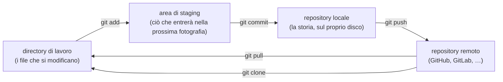

# Git: controllo di versione

`git` registra la storia di una cartella. Ogni volta che si decide, la fotografa
per intero e conserva lo scatto: da quel momento è possibile sapere che cosa è
cambiato, quando, e per mano di chi, e tornare indietro senza avere conservato
copie con il nome `relazione-finale-v3-DEFINITIVA-vera.md`.

Serve a una persona sola tanto quanto a un gruppo. Per una persona sola è un
quaderno che ricorda; per un gruppo è anche il modo di scambiarsi il lavoro
senza sovrascriverselo a vicenda.

---

## 1. I quattro luoghi

Il punto che rende `git` comprensibile è che i file **non stanno in un posto
solo**. Ce ne sono quattro, e ogni comando serve a spostare qualcosa dall'uno
all'altro.



| Luogo | Che cos'è | Dove sta |
|---|---|---|
| Directory di lavoro | I file come si vedono e si modificano | La cartella, in chiaro |
| Area di staging | La selezione di ciò che entrerà nel prossimo scatto | `.git/`, invisibile |
| Repository locale | Tutta la storia, ogni scatto mai fatto | `.git/`, invisibile |
| Repository remoto | La stessa storia, su una macchina altrui | In rete |

⚠️ **L'area di staging è il passaggio che sorprende chi viene da altri
strumenti.** Modificare un file non basta perché finisca nella storia: va prima
**selezionato** con `git add`. Chi lo dimentica esegue `git commit` e si sente
rispondere *nothing added to commit*.

---

## 2. Configurazione, una volta per macchina

`git` firma ogni scatto con un nome e un indirizzo. Senza, rifiuta di lavorare.

```bash
git --version                          # versione installata
git config --global user.name "Nome Cognome"
git config --global user.email "indirizzo@esempio.it"
git config --global init.defaultBranch main
git config --global --list             # la configurazione attiva
```

`--global` scrive in `~/.gitconfig` e vale per ogni repository dell'utente.
Omettendolo si scrive in `.git/config`, e vale per il solo repository corrente:
utile quando un progetto va firmato con un indirizzo diverso dagli altri.

---

## 3. Avviare: due situazioni, due comandi

Le vie d'ingresso sono due, e si sbaglia solo scegliendo quella dell'altro caso.

### 3.1 Il repository non esiste: `git init`

Una cartella che si ha già, e di cui si vuole cominciare a tenere la storia.

```bash
mkdir quaderno && cd quaderno
git init                               # crea .git/ e null'altro
git status                             # dove sono
```

### 3.2 Il repository esiste già altrove: `git clone`

Il caso del lavoro altrui, o del proprio lavoro su una seconda macchina.
`clone` scarica **l'intera storia**, non l'ultima versione soltanto, e crea da
sé la cartella.

```bash
git clone git@github.com:utente/quaderno.git       # via SSH
git clone https://github.com/utente/quaderno.git   # via HTTPS
cd quaderno
```

`clone` configura anche il collegamento al remoto, che prende il nome
convenzionale `origin`: dopo un `clone`, `push` e `pull` funzionano senza altro
da dichiarare.

⛔ **`init` su una cartella già clonata non serve a nulla e confonde.** Una
delle due vie, mai entrambe.

---

## 4. Il ciclo quotidiano

Sono tre comandi, e si ripetono per tutta la vita del progetto.

```bash
git status                             # dove sono   ← prima e dopo ogni operazione
git add <file>                         # seleziona per la prossima fotografia
git add -A                             # seleziona tutto ciò che è cambiato
git commit -m "messaggio"              # scatta la fotografia
git log                                # la storia
git log --oneline --graph              # la storia in forma leggibile
git diff                               # che cosa è cambiato e non è ancora selezionato
git diff --staged                      # che cosa è selezionato e non ancora fotografato
git show <identificativo>              # un singolo scatto, per esteso
```

**`git status` va eseguito prima e dopo ogni operazione.** Non è pedanteria:
è il comando che dice in quale dei quattro luoghi si trova ciò che si sta
guardando, e risparmia la maggior parte degli errori.

**Il messaggio del commit non è un adempimento.** Viene riletto a mesi di
distanza, quando si cerca dove qualcosa si è rotto. `"aggiornato file"` non dice
nulla; `"N4: corretto il ciclo che non terminava"` dice tutto.

---

## 5. Collegare un remoto, e mandare

Necessario solo per un repository nato con `init`: dopo un `clone` il
collegamento c'è già.

```bash
git remote add origin git@github.com:utente/quaderno.git
git remote -v                          # verso quali indirizzi si parla
git push -u origin main                # manda, e ricorda dove
```

`-u` va usato **la prima volta soltanto**: stabilisce la corrispondenza fra il
ramo locale `main` e quello remoto, sicché da lì in poi basta `git push`.

---

## 6. Riprendere il lavoro altrui, o il proprio: `git pull`

`pull` porta nella directory di lavoro ciò che nel frattempo è cambiato sul
remoto. È il comando che rende possibile lavorare su due macchine.

```bash
git pull                               # scarica e innesta in un colpo solo
git fetch                              # scarica soltanto, senza toccare i file
git log HEAD..origin/main --oneline    # che cosa è arrivato, prima di innestarlo
```

**La regola che evita quasi ogni guaio: `pull` all'inizio, `push` alla fine.**
Chi comincia a lavorare senza `pull` si costruisce da sé il conflitto che dovrà
poi risolvere.

### 6.1 Quando `pull` si ferma

Due rifiuti, con due rimedi diversi.

**a) Modifiche locali non fotografate.** `git` non sovrascrive ciò che non è
stato salvato nella storia:

```
error: Your local changes to the following files would be overwritten by merge
```

Rimedio: fotografarle (`git add` + `git commit`), oppure metterle da parte con
`git stash` e riprenderle dopo con `git stash pop`.

**b) Conflitto vero.** La stessa riga dello stesso file è stata cambiata da due
parti. `git` non decide al posto di nessuno: marca il punto dentro il file e si
ferma.

```
<<<<<<< HEAD
la versione locale
=======
la versione arrivata dal remoto
>>>>>>> origin/main
```

Rimedio: aprire il file, **cancellare le tre righe di marcatura** e lasciare il
testo voluto — che può essere l'una, l'altra, o una fusione delle due — poi:

```bash
git add <file>                         # dichiara il conflitto risolto
git commit                             # chiude l'innesto
```

---

## 7. La chiave SSH, per non digitare la password ogni volta

GitHub non accetta più la password sull'`https`. Le vie sono due: un *token*
personale, oppure una coppia di chiavi. La seconda si configura una volta e non
si tocca più.

```bash
ssh-keygen -t ed25519 -C "nome"        # genera la coppia di chiavi
cat ~/.ssh/id_ed25519.pub              # la chiave PUBBLICA, l'unica da dare
ssh -T git@github.com                  # prova l'identità verso GitHub
```

La chiave pubblica va incollata nel proprio profilo GitHub, sotto
*Settings → SSH and GPG keys*. La prova riuscita risponde così — e il
`does not provide shell access` **non è un errore**:

```
Hi <utente>! You've successfully authenticated, but GitHub does not provide shell access.
```

⛔ **`id_ed25519`, senza `.pub`, è la chiave PRIVATA e non si consegna a
nessuno, per nessun motivo.** Si dà soltanto il file che termina in `.pub`.

---

## 8. Compendio

```
git --version                       versione installata
git config --global --list          la configurazione attiva
git init                            crea il repository
git clone <url>                     copia un repository esistente, con la storia
git status                          dove sono  ← prima e dopo ogni operazione
git add <file>                      seleziona per la prossima fotografia
git commit -m "messaggio"           scatta la fotografia
git log                             la storia
git diff                            che cosa è cambiato
git remote add origin <url>         collega il repository remoto
git push -u origin main             manda, e ricorda dove
git pull                            riprende ciò che è cambiato sul remoto
ssh-keygen -t ed25519 -C "nome"     genera la coppia di chiavi
cat ~/.ssh/id_ed25519.pub           la chiave PUBBLICA, l'unica da dare
ssh -T git@github.com               prova l'identità verso GitHub
```

---

## 9. La mappa dei sottocomandi

`git` senza argomenti elenca i propri sottocomandi raggruppati per situazione.
La tabella che segue è quell'elenco, con l'indicazione di che cosa serve subito
e che cosa si incontra più avanti.

### Avviare un'area di lavoro

| Comando | Che cosa fa | |
|---|---|---|
| `clone` | Copia un repository in una cartella nuova | subito |
| `init` | Crea un repository vuoto, o reinizializza quello esistente | subito |

### Lavorare sulle modifiche correnti

| Comando | Che cosa fa | |
|---|---|---|
| `add` | Seleziona il contenuto di un file per il prossimo commit | subito |
| `mv` | Sposta o rinomina un file, una directory, un collegamento | subito |
| `rm` | Toglie file dalla directory di lavoro e dalla selezione | subito |
| `restore` | Riporta i file allo stato dell'ultimo commit | utile |

### Esaminare la storia e lo stato

| Comando | Che cosa fa | |
|---|---|---|
| `status` | Lo stato della directory di lavoro | subito |
| `log` | La storia dei commit | subito |
| `diff` | Le differenze fra commit, indice e directory di lavoro | subito |
| `show` | Mostra un oggetto qualsiasi: commit, tag, file | utile |
| `grep` | Cerca un'espressione dentro i file tracciati | utile |
| `bisect` | Ricerca binaria del commit che ha introdotto un guasto | più avanti |

### Far crescere e correggere la storia

| Comando | Che cosa fa | |
|---|---|---|
| `commit` | Registra le modifiche nel repository | subito |
| `branch` | Elenca, crea o cancella i rami | più avanti |
| `switch` | Passa da un ramo all'altro | più avanti |
| `merge` | Unisce due o più storie di sviluppo | più avanti |
| `tag` | Crea, elenca, cancella o verifica le etichette | più avanti |
| `reset` | Riporta `HEAD` o l'indice a uno stato noto | ⚠️ con cautela |
| `rebase` | Riapplica i commit su un'altra base | ⚠️ con cautela |
| `history` | Riscrittura della storia — **sperimentale** | ⛔ da evitare |

### Collaborare

| Comando | Che cosa fa | |
|---|---|---|
| `push` | Manda al remoto i commit e gli oggetti collegati | subito |
| `pull` | Scarica dal remoto e innesta nel ramo corrente | subito |
| `fetch` | Scarica soltanto, senza innestare | utile |

⚠️ **`reset` e `rebase` riscrivono la storia.** Su un repository personale sono
recuperabili; su un ramo già condiviso con altri creano disallineamenti che
qualcun altro dovrà risolvere. Si imparano dopo, non insieme al resto.

### La documentazione, che è già sulla macchina

```bash
git help <comando>                  # la pagina di manuale di quel comando
git help -a                         # tutti i sottocomandi disponibili
git help -g                         # le guide concettuali
git help tutorial                   # l'avvio, guidato
git help everyday                   # l'uso quotidiano
git help workflows                  # i modi di collaborare
```

---

## 10. Gli errori che capitano per primi

| Sintomo | Causa | Rimedio |
|---|---|---|
| `nothing added to commit` | Modificato ma non selezionato | `git add <file>` |
| `Please tell me who you are` | Nome e indirizzo non configurati | §2 |
| `Permission denied (publickey)` | Chiave assente o non caricata su GitHub | §7 |
| `Updates were rejected` | Il remoto è avanti | `git pull`, poi `git push` |
| `Your local changes would be overwritten` | Modifiche non fotografate | commit, oppure `git stash` |
| `detached HEAD` | Si è passati a un commit invece che a un ramo | `git switch main` |
| `fatal: not a git repository` | Si è fuori dalla cartella del repository | `cd`, oppure `git init` |

---

## 11. Che cosa non mettere in un repository

La storia di `git` è **permanente**: un file cancellato in un commit successivo
resta leggibile in quelli precedenti, e toglierlo davvero richiede la
riscrittura della storia.

⛔ **Non vanno mai committati**: password, chiavi private, token, file `.env`,
certificati. Non vanno committati, e non basta cancellarli dopo.

Ciò che va escluso si dichiara in `.gitignore`, nella radice del repository:

```
*.log
*.tmp
.env
node_modules/
__pycache__/
```

⚠️ **`.gitignore` vale per i file non ancora tracciati.** Un file già entrato
nella storia continua a essere seguito anche dopo averlo aggiunto all'elenco:
va prima tolto dalla selezione con `git rm --cached <file>`.

